# MediFlow

**Agente de triagem de documentos clínicos.** Lê um documento em texto, PDF ou imagem, classifica, extrai os dados em JSON e o encaminha para o setor certo, deixando para uma pessoa só os casos que a máquina não deve decidir sozinha.

Projeto do **Hackathon ONE G10** (Oracle Next Education e Alura).

[](https://github.com/No-Country-simulation/g10-Brasil27/actions/workflows/testes.yml)
[](requirements.txt)
[](docs/deploy-oci.md)

---

## Demonstração

**No ar: http://137.131.182.189**

Ambiente de demonstração do hackathon, em HTTP, somente com dados fictícios e tetos diários (100 documentos e 300 MB por dia). Não envie documentos de pacientes reais.

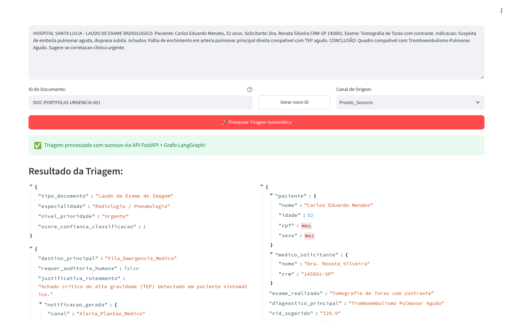

*Envio do cenário de urgência: o painel mostra a classificação, o roteamento (com o alerta ao plantão) e os dados extraídos.*

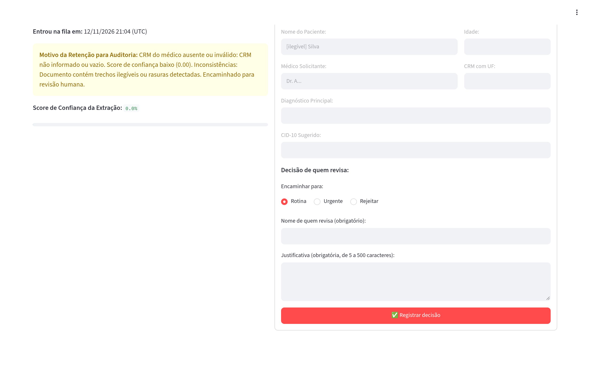

*Fila de auditoria: o receituário ilegível ficou retido, com o motivo da retenção, o score e o formulário de decisão.*

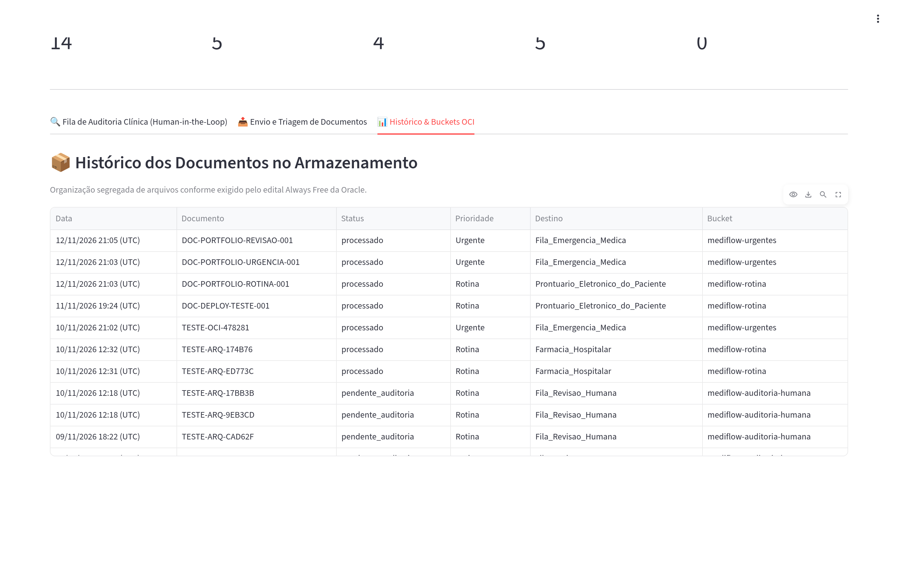

*Histórico: cada documento com o status, o destino e o bucket onde foi gravado.*

## O problema e a solução

Um serviço de saúde recebe documentos em formatos diferentes (laudos, receitas, guias), e cada um precisa chegar ao setor certo. Um laudo com achado crítico não pode esperar na fila, e um documento ilegível ou sem CRM não deve seguir adiante sem que uma pessoa o confira.

O MediFlow automatiza essa triagem: lê o documento (inclusive PDF escaneado e imagem, pela visão do Gemini), classifica e extrai os dados, aplica regras clínicas e grava o resultado em um bucket do Object Storage por destino. A urgência crítica vai primeiro para a fila de emergência, com um alerta ao plantão. O que for ambíguo vai para uma fila de **revisão humana (Human-in-the-Loop)**, onde a pessoa decide o destino e registra a justificativa.

## Funcionalidades

- Recebe o documento como **texto**, **PDF** (com texto ou escaneado) ou **imagem** (PNG, JPG, JPEG e WEBP).
- **Classifica** o tipo do documento e **extrai** os dados clínicos em JSON validado por contratos Pydantic, usando o Gemini. Sem chave do Gemini, ou se a chamada falhar, entra um motor determinístico local.
- Calcula um **score de confiança** e lista as **pendências** de cada documento.
- **Roteia por regras clínicas:** emergência, revisão humana ou destino por tipo de documento.
- Gera um **alerta ao plantão** para a urgência crítica (no JSON de saída).
- **Fila de auditoria humana:** quem revisa escolhe `rotina`, `urgente` ou `rejeitado`, com nome e justificativa. A trilha guarda também o que o grafo tinha decidido.
- **Histórico e contadores** no painel, lidos da API.
- **Armazenamento segregado** em cinco buckets privados, um por status.
- **API protegida:** chave de acesso, corpo de até 15 MB, tetos diários e cache das listagens.
- **Deploy** em Docker Compose, atrás de nginx, numa VM ARM da OCI Always Free.

## Requisitos do Hackathon ONE

| Item do edital | Evidência |
|---|---|
| Ingestão de texto, PDF e imagem | `agente/leitor_documentos.py` (texto, PDF com texto pelo `pypdf`, PDF escaneado e imagem em Base64) e `api/validacao.py` (aceita PDF, PNG, JPG, JPEG, WEBP e TXT). Na aba "Envio e Triagem" do painel, os modos "Texto do documento" e "Enviar arquivo PDF ou imagem". O texto está demonstrado nas telas dos [3 cenários](#os-3-cenários), que usam texto. A ingestão de imagem em Base64 e de PDF digitalizado é testada em `tests/test_agente.py`, e o arquivo que não abre, em `tests/test_leitor.py` |
| Classificação com LLM | `agente/visao_multimodal.py` (Gemini com saída estruturada) e `prompts/`. A resposta traz `tipo_documento`, `especialidade` e `nivel_prioridade` ([telas](#os-3-cenários)) |
| Extração em JSON | Contratos Pydantic em `contratos/modelos.py` (`TriagemResposta` e `DadosExtraidos`). Veja o [exemplo de saída](#exemplo-do-json-de-saída) |
| Lógica condicional | `regras/regras_clinicas.py` (regras de roteamento) e a aresta condicional do grafo em `agente/grafo.py`. Veja o [fluxo de decisão](#fluxo-de-decisão) |
| Object Storage com buckets segregados | Cinco buckets privados, um por status (`armazenamento/repositorio.py`, `api/triagem.py`). Telas [`oci-02`](docs/imagens/oci-02-buckets.png) e [`oci-03`](docs/imagens/oci-03-objetos-rotina.png) |
| Os 3 cenários | `dados_teste/` e as telas do site no ar, na seção [Os 3 cenários](#os-3-cenários) |
| Diagrama do fluxo | Seção [Fluxo de decisão](#fluxo-de-decisão) |
| Arquitetura | Seção [Arquitetura](#arquitetura) |
| Instruções de execução | Seção [Como rodar](#como-rodar) e [`docs/rodar-localmente.md`](docs/rodar-localmente.md) |
| Commits documentados | 50 dos 51 commits da `main` (sem contar os merges) seguem `tipo(escopo): descrição`; a exceção é um upload pelo GitHub (`ef31d47`). A [linha do tempo](docs/historico.md) cita os PRs #1 a #8 e os commits principais |
| Diferencial: deploy em OCI Compute | Site no ar numa VM `VM.Standard.A1.Flex`. Guia em [`docs/deploy-oci.md`](docs/deploy-oci.md) e telas [`oci-00`](docs/imagens/oci-00-shape-always-free.png) e [`oci-01`](docs/imagens/oci-01-instancia.png) |
| Diferencial: painel Human-in-the-Loop | Aba "Fila de Auditoria Clínica" em `interface/app.py` e endpoints `/api/v1/auditoria/...` em `api/auditoria.py`. Telas [`painel-04`](docs/imagens/painel-04-fila-auditoria.png) a [`painel-06`](docs/imagens/painel-06-historico.png) |
| Diferencial: OCR e visão multimodal | O Gemini lê PDF escaneado e imagem: `agente/visao_multimodal.py` envia os bytes do arquivo ao modelo com o prompt `PROMPT_OCR_MULTIMODAL`. Não há um motor de OCR separado: o OCR é feito pelo próprio Gemini. O código registra que o modelo foi testado com texto, PNG e PDF escaneado, e a ingestão que prepara a imagem e o PDF digitalizado para essa leitura é testada em `tests/test_agente.py`. **Não há teste automatizado que envie um arquivo real ao Gemini** |

## Os 3 cenários

Os três cenários de `dados_teste/` foram enviados ao site no ar pelo painel, um por vez. **Os três destinos coincidem com o `resposta_esperada` de cada `exemplo.json`.** Valores como o score variam com o modelo (por exemplo, `1` no resultado real contra `0,98` no gabarito do cenário 1).

| # | Entrada (resumo) | Destino | Bucket | Tela |
|---|---|---|---|---|
| 1 | Laudo de hemograma completo, sem achados críticos, com CRM válido | `Prontuario_Eletronico_do_Paciente` | `mediflow-rotina` | [`painel-01`](docs/imagens/painel-01-envio-rotina.png) |
| 2 | Laudo de tomografia de tórax com tromboembolismo pulmonar agudo | `Fila_Emergencia_Medica`, com alerta `Alerta_Plantao_Medico` | `mediflow-urgentes` | [`painel-02`](docs/imagens/painel-02-envio-urgencia.png) |
| 3 | Receituário com trechos ilegíveis e rasurados, sem CRM | `Fila_Revisao_Humana` (score 0, retido) | `mediflow-auditoria-humana` | [`painel-03`](docs/imagens/painel-03-envio-revisao.png) |

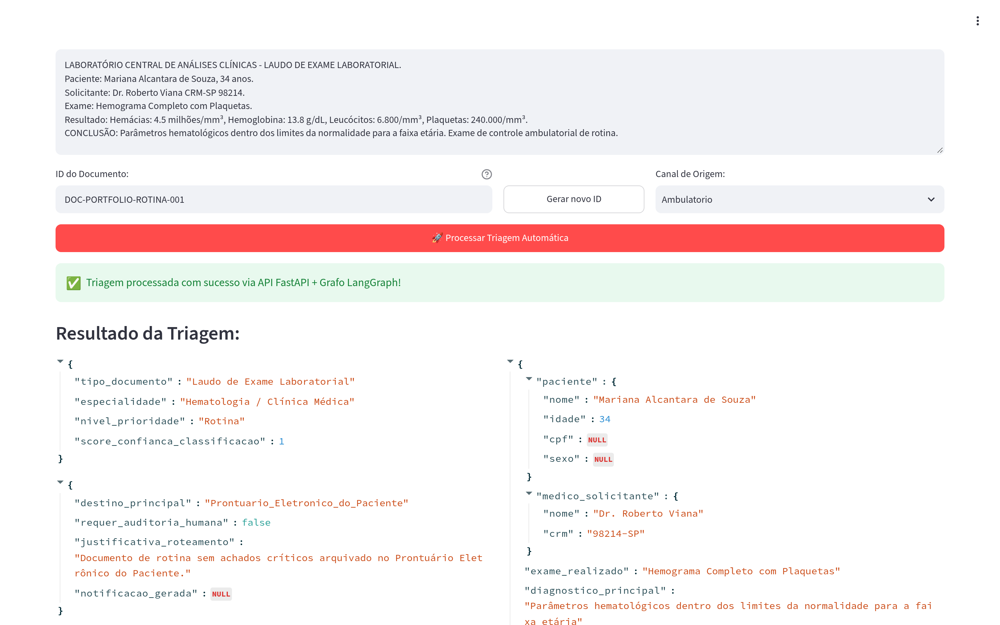

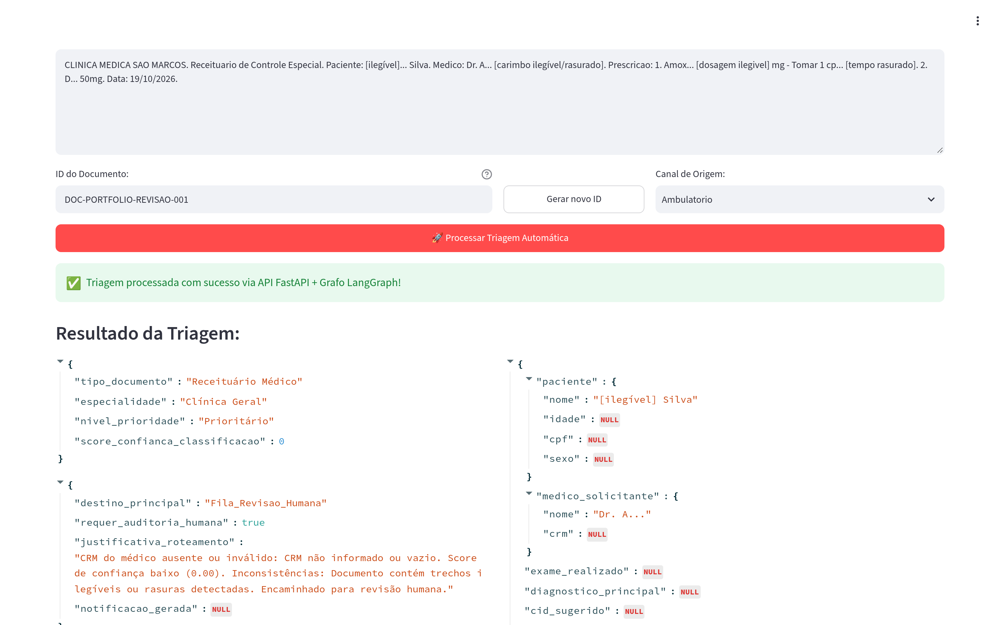

**Depois da revisão.** O documento retido do cenário 3 foi aberto na fila de auditoria e decidido como `urgente`, por uma revisora fictícia e com justificativa. O painel respondeu: *"Documento DOC-PORTFOLIO-REVISAO-001 encaminhado para Fila_Emergencia_Medica (bucket mediflow-urgentes). A decisão ficou registrada."* A fila passou de 6 para 5 documentos e as emergências de 3 para 4. O [histórico](docs/imagens/painel-06-historico.png) mostra o documento já em `mediflow-urgentes`.

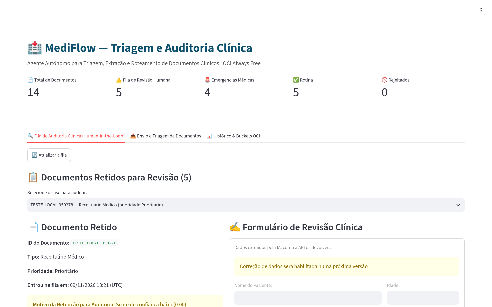

*Painel aberto de novo depois da decisão: a fila já não traz o documento decidido, e os contadores mostram 14 documentos, 5 na fila de revisão e 4 emergências. A mensagem de confirmação, citada acima, aparece só no momento do registro.*

Os buckets dos cenários 1 e 2 estão no [histórico](docs/imagens/painel-06-historico.png). O do cenário 3, antes da decisão, é o `mediflow-auditoria-humana`, pelo mapa de destino para bucket em `api/triagem.py`. Rodando os mesmos três cenários numa API local, sem chave do Gemini, o resultado foi o mesmo: rotina em `mediflow-rotina`, urgência em `mediflow-urgentes` e o cenário 3 retido em `mediflow-auditoria-humana`.

## Exemplo do JSON de saída

Resposta real da triagem do cenário de urgência (`DOC-PORTFOLIO-URGENCIA-001`), como o painel a mostra. O paciente é fictício. A API devolve ainda `status`, `documento_id` e `armazenamento_oci` (o bucket e o caminho do objeto), que o painel não exibe.

```json
{
  "classificacao": {
    "tipo_documento": "Laudo de Exame de Imagem",
    "especialidade": "Radiologia / Pneumologia",
    "nivel_prioridade": "Urgente",
    "score_confianca_classificacao": 1
  },
  "decisao_roteamento": {
    "destino_principal": "Fila_Emergencia_Medica",
    "requer_auditoria_humana": false,
    "justificativa_roteamento": "Achado crítico de alta gravidade (TEP) detectado em paciente sintomático.",
    "notificacao_gerada": {
      "canal": "Alerta_Plantao_Medico",
      "mensagem": "ALERTA URGENTE: Laudo critico de Tromboembolismo Pulmonar Agudo para paciente Carlos Eduardo Mendes no Pronto_Socorro."
    }
  },
  "dados_extraidos": {
    "paciente": { "nome": "Carlos Eduardo Mendes", "idade": 52, "cpf": null, "sexo": null },
    "medico_solicitante": { "nome": "Dra. Renata Silveira", "crm": "145892-SP" },
    "exame_realizado": "Tomografia de Torax com contraste",
    "diagnostico_principal": "Tromboembolismo Pulmonar Agudo",
    "cid_sugerido": "I26.9",
    "medicamentos": null,
    "observacoes_clinicas": "Falha de enchimento em arteria pulmonar principal direita compativel com TEP agudo. Exame com achados críticos indicando risco imediato à vida. Requer correlação clínica urgente."
  }
}
```

## Arquitetura

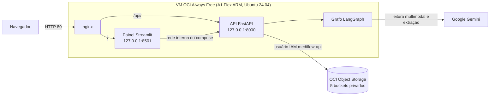

O navegador entra pelo nginx, na porta 80 (HTTP), que repassa o painel Streamlit e a API FastAPI, os dois em containers na mesma VM ARM da OCI Always Free. A API roda o grafo LangGraph, que consulta o Gemini, e grava o resultado no Object Storage com um usuário IAM de menor privilégio.

## Fluxo de decisão

A ordem abaixo é a do código (`agente/grafo.py` e `regras/regras_clinicas.py`).

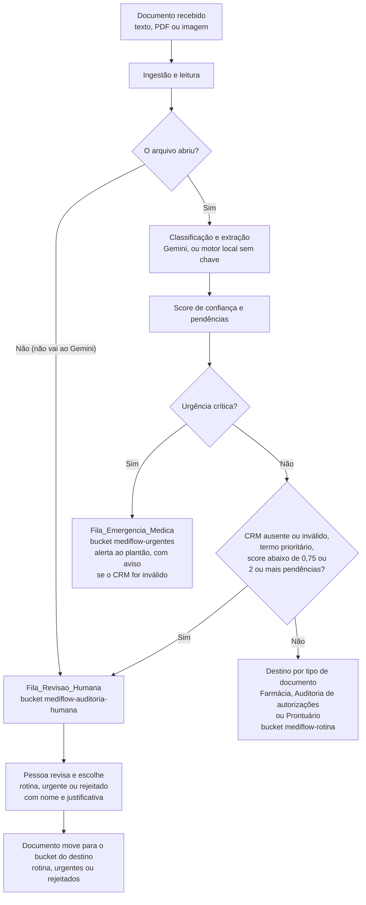

1. **Urgência crítica** vai para `Fila_Emergencia_Medica` antes de qualquer outra regra, **mesmo com o CRM ausente ou inválido** (o alerta e a justificativa trazem um aviso).
2. **CRM ausente ou inválido, termo prioritário, score abaixo de 0,75 ou 2 ou mais pendências** vão para `Fila_Revisao_Humana`.
3. Os **demais** seguem o destino por tipo de documento.
4. **Arquivo que não abre** vai para a revisão, sem passar pelo Gemini. Esse teste vem primeiro no código, porque sem arquivo lido não há o que avaliar.
5. Na revisão, a pessoa escolhe `rotina`, `urgente` ou `rejeitado`, com nome e justificativa.

## Deploy na OCI e custo

O MediFlow roda numa VM `VM.Standard.A1.Flex` (Ampere, 1 OCPU e 5 GB, Ubuntu 24.04), elegível ao Always Free, na região de São Paulo.

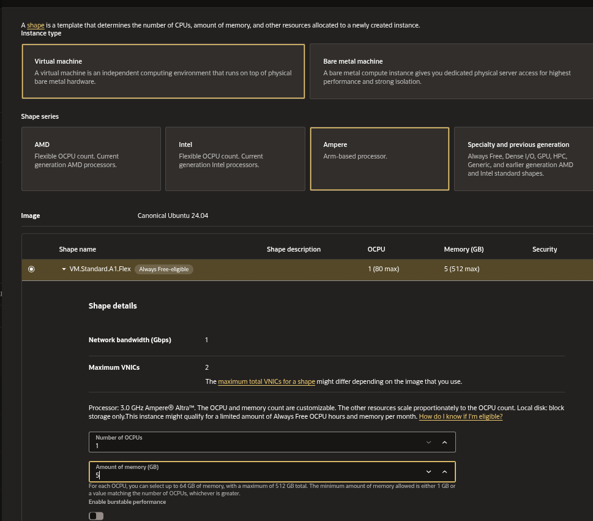

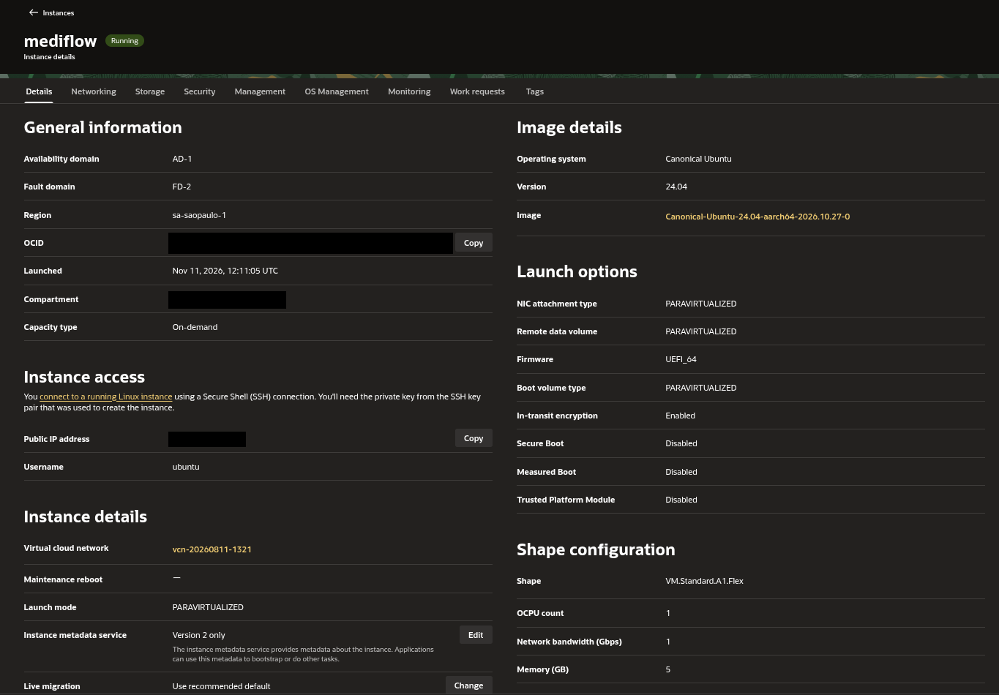

Os documentos vão para **cinco buckets privados**, um por status, e cada documento vira um objeto JSON no bucket do seu destino:

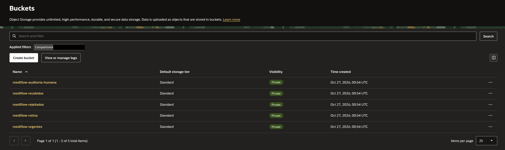

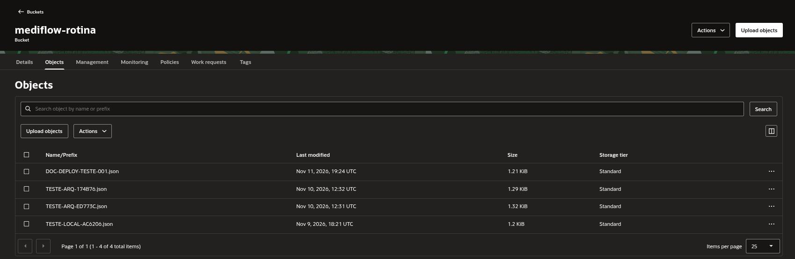

**Custo zero.** O Cost Analysis da conta mostra **R$ 0,00** de 14/10 a 12/11/2026:

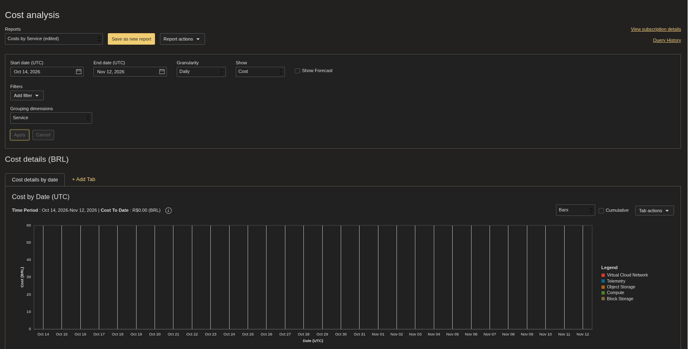

**Menor privilégio.** A API grava com um usuário IAM dedicado, o `mediflow-api`. A política só lê o namespace e os buckets da tenancy e **gerencia buckets e objetos somente onde `target.bucket.name = /mediflow-*/`**:

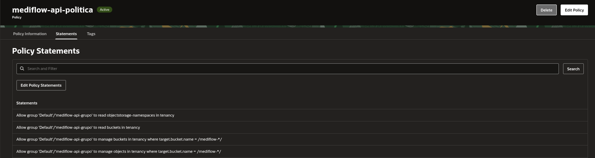

O passo a passo completo, com o porquê de cada cuidado, está em [`docs/deploy-oci.md`](docs/deploy-oci.md).

## Stack

| Camada | Tecnologia | Versão |
|---|---|---|
| Linguagem | Python | 3.13 (imagem `python:3.13-slim` no Dockerfile e Python 3.13 no CI) |
| API | FastAPI | 0.162.0 |
| Servidor da API | Uvicorn | 0.54.0 |
| Painel | Streamlit | 1.66.0 |
| Cliente HTTP do painel | requests | 2.34.2 |
| Contratos e validação | Pydantic | 2.14.1 |
| Agente (grafo de decisão) | LangGraph | 1.2.18 |
| LLM (SDK) | google-genai | 1.75.0 |
| LLM (modelo) | Gemini `gemini-3.5-flash-lite` | padrão em `agente/visao_multimodal.py` |
| Leitura de PDF | pypdf | 6.21.2 |
| Leitura de imagem | Pillow | 12.3.0 |
| Armazenamento | SDK da OCI (`oci`) | 2.189.0 |
| Configuração | python-dotenv | 1.2.4 |
| Fusos horários | tzdata | 2026.6 |
| Cliente HTTP (timeout do SDK do Gemini e `TestClient` dos testes da API) | httpx | 0.28.1 |
| Testes | pytest | 9.1.1 |
| Containers | Docker e Docker Compose | imagem `python:3.13-slim`, multi-stage, usuário não-root (uid 10001) |
| Proxy | nginx | pacotes do Ubuntu 24.04, sem versão fixa no repositório |
| Nuvem | OCI: VM `VM.Standard.A1.Flex` e Object Storage | 1 OCPU, 5 GB, Ubuntu 24.04 `aarch64` |
| CI | GitHub Actions | `actions/checkout@v4` e `actions/setup-python@v5`, Python 3.13 |

## Como rodar

O guia completo, com os comandos do Windows (PowerShell) e do Linux, está em [`docs/rodar-localmente.md`](docs/rodar-localmente.md). Em resumo, com o Python 3.13 e o Git:

```bash
git clone https://github.com/No-Country-simulation/g10-Brasil27.git
cd g10-Brasil27
python3.13 -m venv .venv && source .venv/bin/activate     # Windows: py -3.13 -m venv .venv
pip install -r requirements.txt
cp .env.example .env                                      # Windows: Copy-Item .env.example .env
```

No `.env`, preencha `MEDIFLOW_ARMAZENAMENTO=local` e uma `MEDIFLOW_API_KEY` que **você mesmo gera** (cada ambiente tem a sua; o comando está no guia). A chave do Gemini (`LLM_API_KEY`) é opcional: sem ela, entra o motor determinístico. Depois, em dois terminais, com o `.venv` ativo:

```bash
python -m uvicorn api.main:app --reload      # terminal 1: API em http://localhost:8000
python -m streamlit run interface/app.py     # terminal 2: painel em http://localhost:8501
```

## Testes

O `pytest` coleta e roda **710 testes** (e mais 9 subtestes), todos passando, em cerca de 21 segundos. Eles **nunca chamam o Gemini de verdade**: um `conftest.py` esvazia as variáveis da chave em cada teste, e os que precisam do modelo usam um cliente falso ou um servidor HTTP local. **Também não há teste contra a OCI real:** o armazenamento OCI é testado com um cliente falso.

| Área | Arquivo | Testes |
|---|---|---|
| Regras clínicas: urgência, CRM, score e roteamento | `tests/test_regras.py` | 131 |
| Segurança da API: chave, 401, 413 e tetos diários (429) | `tests/test_seguranca.py` | 99 |
| API de triagem: contrato, 409, 422 e 503 | `tests/test_api.py` | 75 |
| Painel Streamlit (no `AppTest` do próprio Streamlit) | `tests/test_painel.py` | 67 |
| Modo sem IA (motor determinístico): não inventa dados, o que falta vai para a revisão | `tests/test_fallback.py` | 60 |
| Auditoria humana pela API | `tests/test_auditoria.py` | 54 |
| Contratos Pydantic | `tests/test_contratos.py` | 46 |
| Armazenamento (modo local e modo OCI com cliente falso) | `tests/test_armazenamento.py` e `tests/test_armazenamento_auditoria.py` | 42 e 41 |
| Cache das listagens | `tests/test_cache_listagens.py` | 31 |
| Gemini: novas tentativas (cliente falso) e o SDK real contra um servidor HTTP local | `tests/test_gemini.py` | 27 |
| Leitura: arquivo que não abre nunca vai ao Gemini | `tests/test_leitor.py` | 23 |
| Grafo de decisão e ingestão multimodal | `tests/test_agente.py` | 14 |

Os testes rodam no **CI** (GitHub Actions, `.github/workflows/testes.yml`) em todo push e em todo pull request, sem segredos, com Python 3.13.

## Equipe

| Nome | GitHub | Área | O que fez, como e onde |
|---|---|---|---|
| Lethicia Almeida | [@Lethicia-almzd](https://github.com/Lethicia-almzd) | Contratos de dados, regras clínicas e painel | **Contratos de dados** em Pydantic (`contratos/modelos.py`, `92f37ec`). **Regras clínicas:** validação do CRM, score de confiança, critérios de urgência e roteamento (`regras/regras_clinicas.py`, `92f37ec`). **Cenários de teste** (`dados_teste/`, `92f37ec`). **Painel de auditoria e tela de triagem** em Streamlit (`interface/app.py`, `7a3c54b`). PRs #1 e #4 |
| Ingrid Soares | [@ingrdsoares](https://github.com/ingrdsoares) | Agente de IA, prompts e infraestrutura | **Grafo LangGraph** (`agente/grafo.py`, `b70edb6`), **leitura multimodal** (`agente/leitor_documentos.py` e `agente/visao_multimodal.py`, `8196fc5`) e **prompts** (`prompts/`, `b125a02`, `997aa2d`). **Infraestrutura:** `Dockerfile` e compose (`4047ef4`), nginx e script de setup (`fed7b8a`). **Integração:** API ligada ao grafo (`db47d5e`) e painel ligado à API e ao grafo (`f9f082d`). **Correção do schema do Gemini** (`9e385f4`, `78176dc`). PRs #2, #5 e #6 |
| Guilherme Araujo Silva | [@Guilherme-Araujo-silva](https://github.com/Guilherme-Araujo-silva) | Tela de envio de documentos | **Tela inicial de envio** (`app.py`, `api_client.py`, `schemas.py` e `EXEMPLOS_DEMO.md`, `6be4317`, na branch `feature/documentos-guilherme`, fora da `main`) e **página de envio de arquivos** (`1_Envio_de_Arquivos.py`, `ef31d47`). A lógica de envio dele foi integrada à aba de envio do painel, com ele como coautor (`2a1ce95`) |
| André Teixeira | [@AndreTeixeir](https://github.com/AndreTeixeir) | API, armazenamento, integração e deploy | **Estrutura inicial do repositório** (`64ff7eb`). **API FastAPI e armazenamento OCI/local** (`api/` e `armazenamento/`, `edf65c8`). **Integrações** da fase 1 (branch `integracao/fase-1`) e da fase 2 (`integracao/fase-2`, PR #7). **Chave de acesso, limite de 15 MB e tetos diários** (`api/seguranca.py`, `8e6e845`, `d7b0e42`, `fe5c765`). **API de auditoria, cache e cliente do painel** (`api/auditoria.py`, `api/cache_listagens.py` e `interface/cliente_api.py`, `f3ade5f`, `743db9c`, `97fcb09`). **Fila de auditoria pela API** (`97fcb09`). **Deploy na OCI:** VM, IAM, buckets, ciclo de vida e nginx ([`docs/deploy-oci.md`](docs/deploy-oci.md)). PRs #3 e #7 |

**Como a autoria é contada.** Vale o **autor do commit** no Git, mais a coautoria pelo `Co-authored-by`. A tag `[Nome]` no fim de algumas mensagens indica a **área** do projeto, não quem escreveu: vários commits do André têm `[Lethicia]`, `[Ingrid]` ou `[Guilherme]` porque mexem na parte dessas pessoas. Por exemplo, as correções nas regras de CRM e de urgência (`c861c9f` e `6e4946e`) são do André, na área da Lethicia.

**Sobre a interface.** O **painel** é da Lethicia (`7a3c54b`). A **ligação do painel com a API e com o grafo** é da Ingrid (`f9f082d`). A **lógica de envio** é do Guilherme, com coautoria no `2a1ce95`. A **integração** e a **fila de auditoria pela API** são do André (`97fcb09`).

## Limitações e próximos passos

- **O painel é público, sem login.** A proteção é a chave da API, que fica no servidor, mais os tetos diários de 100 documentos e 300 MB. Por isso o ambiente aceita só dados fictícios.
- **O ambiente de demonstração usa HTTP, sem HTTPS.** Por isso, só dados fictícios.
- **A correção dos dados extraídos pelo painel está desabilitada:** a tela avisa "Correção de dados será habilitada numa próxima versão" (`interface/app.py`). Quem revisa só escolhe o destino.
- **Os alertas vão só no JSON** (`notificacao_gerada`): não há envio a um canal real, como e-mail ou mensagem ao plantão.
- **O fluxo não é customizável.** O grafo e o limiar de confiança (0,75) são fixos, e a API não expõe o limiar. As listas de termos de urgência estão no código.
- **A negação depois do termo não é tratada:** "TEP descartado" não é reconhecido como negação (`regras/regras_clinicas.py`). A negação **antes** do termo é.
- **O OCR depende do Gemini.** Sem a chave, o motor local lê o texto de um PDF que tem camada de texto, mas não lê PDF escaneado nem imagem.
- **O cache e os contadores dos tetos ficam em memória:** valem para um único worker da API e zeram quando ela reinicia. As listas do painel mostram no máximo 50 itens.
- **A infraestrutura da OCI não está descrita como código no repositório:** os buckets, o ciclo de vida, o orçamento e o usuário IAM existem só na conta da OCI. Versioná-los (IaC) é um próximo passo natural.

## Créditos

Projeto da equipe do **Hackathon ONE G10**: [`No-Country-simulation/g10-Brasil27`](https://github.com/No-Country-simulation/g10-Brasil27).

- [`docs/decisoes-tecnicas.md`](docs/decisoes-tecnicas.md): as decisões técnicas, com o motivo e onde está cada uma.
- [`docs/historico.md`](docs/historico.md): a linha do tempo, com os pull requests e os commits principais.
- [`docs/deploy-oci.md`](docs/deploy-oci.md) e [`docs/rodar-localmente.md`](docs/rodar-localmente.md): o deploy e a execução local.

Todos os documentos usados na demonstração são **fictícios**.
