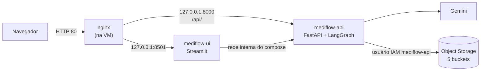
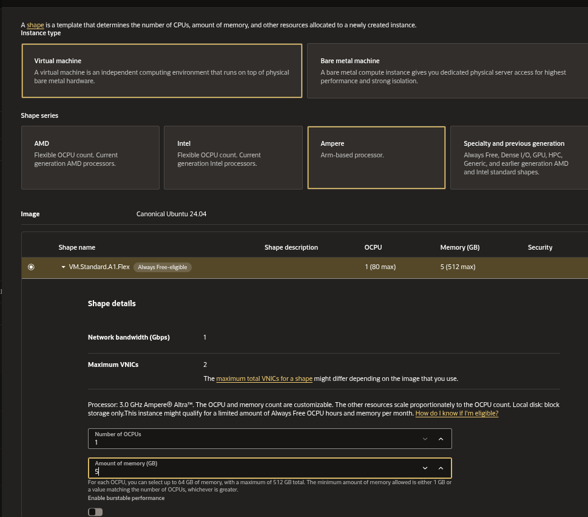
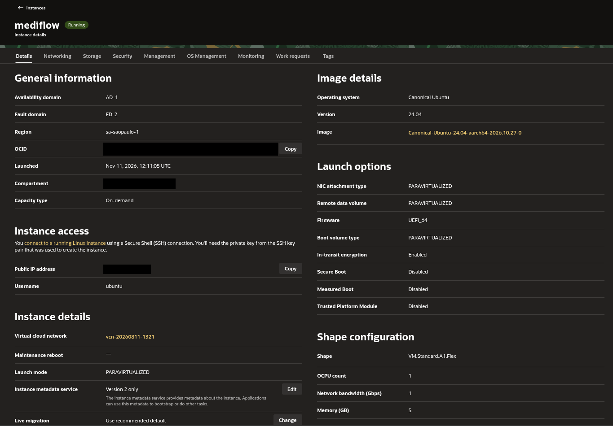
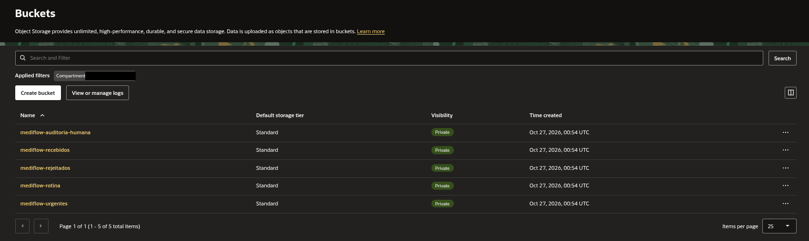
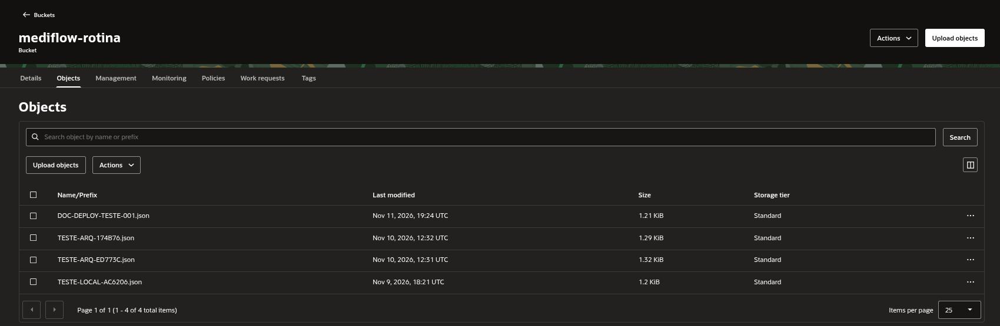
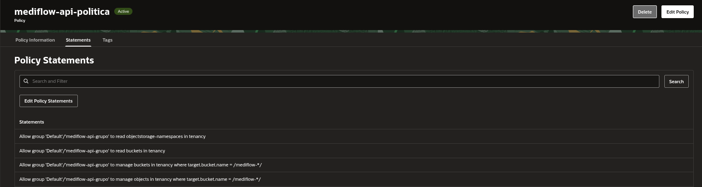
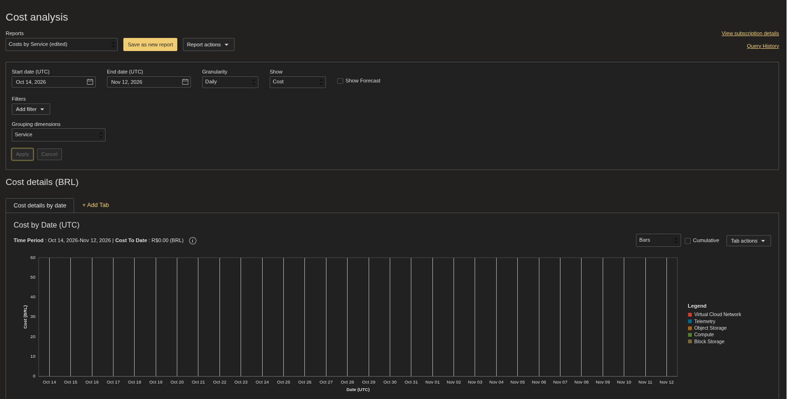

# Deploy do MediFlow na OCI (Always Free)

Passo a passo do deploy do hackathon, acessado pelo IP público da VM, em HTTP, feito em 11/11/2026 numa VM da Oracle Cloud Infrastructure, sem custo.

Os valores sensíveis (OCIDs, namespace, nome da tenancy, chaves) **não aparecem** neste guia: onde eles entram, o texto traz um marcador como `<ocid-do-usuario>` ou `cole-aqui-...`.

## Como as peças se encaixam



O nginx é a única porta de entrada do site (a 80). A API e o painel só escutam em `127.0.0.1` e rodam em dois containers do Docker Compose. A API grava na OCI com um usuário IAM próprio, que só enxerga os buckets `mediflow-*`.

## Índice

1. [VM, rede e portas](#1-vm-rede-e-portas)
2. [Docker](#2-docker)
3. [Buckets, usuário IAM e credencial OCI](#3-buckets-usuário-iam-e-credencial-oci)
4. [O `.env` do servidor](#4-o-env-do-servidor)
5. [Docker Compose](#5-docker-compose)
6. [nginx](#6-nginx)
7. [Testes de verificação](#7-testes-de-verificação)
8. [Custo](#8-custo)

> Parte dos passos 1, 2, 3, 5 e 6 está automatizada em [`deploy/setup_oci_vm.sh`](../deploy/setup_oci_vm.sh): o firewall (`iptables`), o Docker e o grupo `docker`, as permissões do `~/.oci`, o nginx e o compose sem `sudo`. O script **não** cria a credencial da OCI nem o `.env`: esses passos são manuais.

---

## 1. VM, rede e portas

### A VM

| Item | Valor |
|---|---|
| Nome | `mediflow` |
| Forma (shape) | `VM.Standard.A1.Flex` (Ampere, processador ARM), marcada **Always Free-eligible** |
| Recursos | 1 OCPU e 5 GB de memória |
| Sistema | Ubuntu 24.04, `aarch64` |
| Região | São Paulo (`sa-saopaulo-1`) |





O Dockerfile do projeto serve a arquitetura x86_64 e a ARM64 (`python:3.13-slim` tem as duas), então a VM ARM roda a mesma imagem sem ajuste.

### Portas na VCN (Security List)

No console da OCI, na Security List da sub-rede da VM, libere **só** estas portas TCP de entrada:

| Porta | Para quê |
|---|---|
| `22` | SSH (administração, por chave) |
| `80` | HTTP (a entrada do site, pelo nginx) |

As portas `8000` e `8501` **não** são abertas: o `deploy/docker-compose.yml` as publica só em `127.0.0.1`.

### Firewall da VM: iptables, não ufw

A Security List é o firewall da nuvem. A imagem Ubuntu da OCI também traz um firewall **dentro** da VM, com regras de `iptables` que terminam num `REJECT`. Por isso, mesmo com a porta liberada na Security List, o pacote ainda é recusado na VM se não houver uma regra `ACCEPT` **antes** do `REJECT`.

Esta etapa foi feita com `iptables`, e o `ufw` **não foi usado**: como a imagem já gerencia o firewall por `iptables`, ligar o `ufw` por cima criaria um segundo conjunto de regras sobre o primeiro, e a ordem entre eles deixaria de ser óbvia. Adicionar duas linhas ao conjunto que já existe é a mudança menor.

Veja onde está o `REJECT`:

```bash
sudo iptables -L INPUT -n --line-numbers
```

Saída esperada: uma lista numerada de regras, com a linha `REJECT` perto do fim. Libere as portas 80 e 443 **na posição do `REJECT`** (a regra entra antes dele), só se ainda não existirem:

```bash
for porta in 80 443; do
  if ! sudo iptables -C INPUT -m state --state NEW -p tcp --dport "$porta" -j ACCEPT 2>/dev/null; then
    posicao=$(sudo iptables -L INPUT --line-numbers -n | awk '/REJECT/ {print $1; exit}')
    sudo iptables -I INPUT "${posicao:-1}" -m state --state NEW -p tcp --dport "$porta" -j ACCEPT
  fi
done
```

Para as regras sobreviverem a uma reinicialização, instale o `netfilter-persistent` e salve:

```bash
sudo DEBIAN_FRONTEND=noninteractive apt-get install -y iptables-persistent
sudo netfilter-persistent save
```

---

## 2. Docker

Instale o Docker Engine pelo script oficial e coloque o seu usuário no grupo `docker`:

```bash
curl -fsSL https://get.docker.com | sudo sh
sudo usermod -aG docker "$USER"
```

Saia e entre de novo na sessão SSH para o grupo valer. Confira:

```bash
id -nG | tr ' ' '\n' | grep -x docker
docker compose version
```

Saída esperada: a palavra `docker` e a versão do plugin do compose.

**O compose roda sem `sudo`, de propósito.** O `deploy/docker-compose.yml` monta `${HOME}/.oci` dentro do container. Com `sudo`, o `${HOME}` vira `/root`, o compose monta a pasta `/root/.oci` (que não existe) e a API sobe sem credencial. Estando no grupo `docker`, o `sudo` é desnecessário e o `${HOME}` continua sendo o da sua conta.

---

## 3. Buckets, usuário IAM e credencial OCI

### 3.1. Os cinco buckets

Crie cinco buckets **privados**, um por status do documento, todos com o prefixo `mediflow` (é o valor de `OCI_BUCKET_PREFIXO`):

| Bucket | Recebe |
|---|---|
| `mediflow-recebidos` | Todo documento, antes de processar |
| `mediflow-rotina` | Farmácia, autorizações e prontuário |
| `mediflow-urgentes` | Fila de emergência médica |
| `mediflow-auditoria-humana` | Documentos retidos para revisão |
| `mediflow-rejeitados` | Documentos que a revisão rejeita |



A API **não cria** buckets: eles precisam existir antes. Cada documento vira um objeto `<documento_id>.json` no bucket do seu destino:



**Ciclo de vida.** Configure a regra "apagar objetos após 30 dias" em todos os buckets, **menos** em `mediflow-auditoria-humana`. A razão: os documentos pendentes ficam nesse bucket até alguém decidir, e a fila de auditoria é lida dele; uma regra de expiração faria um pendente sumir da fila.

**Orçamento.** Crie um orçamento com alerta para qualquer gasto acima de R$ 0,01. Como o objetivo é custo zero, qualquer cobrança vira aviso.

### 3.2. O usuário IAM `mediflow-api` e a política de menor privilégio

A API não usa a conta do administrador: ela grava com um usuário IAM dedicado, `mediflow-api`, num grupo com uma política que dá o mínimo necessário:



| Permissão | Alcance | Para quê |
|---|---|---|
| `read objectstorage-namespaces` | toda a tenancy | O código descobre o namespace do Object Storage chamando `get_namespace()` quando `OCI_NAMESPACE` está vazia (`armazenamento/repositorio.py`) |
| `read buckets` | toda a tenancy | Leitura dos buckets |
| `manage buckets` | **só** `target.bucket.name = /mediflow-*/` | Gerência dos buckets do projeto |
| `manage objects` | **só** `target.bucket.name = /mediflow-*/` | Gravar, ler, listar e apagar os JSON dos documentos |

O filtro `/mediflow-*/` é o que importa: mesmo que a chave da API vaze, ela não alcança nenhum bucket que não comece com `mediflow-`.

> O código da API usa operações de **objeto** (`put_object`, `get_object`, `list_objects`, `delete_object`) e `get_namespace`. Ele não chama operações de bucket, então as duas linhas de `buckets` não são exercitadas pela API.

### 3.3. A chave de API do usuário e o `~/.oci` na VM

No console da OCI, abra o usuário `mediflow-api` e adicione uma **chave de API**. O console gera o par de chaves e mostra um trecho de configuração; baixe a chave privada. Nesta etapa, os nomes exatos dos menus mudam com a versão do console, então siga o fluxo "usuário → API keys → adicionar".

Na VM, o `~/.oci` fica com **só** o perfil `MEDIFLOW`:

```text
~/.oci/config
~/.oci/mediflow-api.pem
```

```ini
[MEDIFLOW]
user=<ocid-do-usuario-mediflow-api>
fingerprint=<fingerprint-da-chave>
tenancy=<ocid-da-tenancy>
region=sa-saopaulo-1
key_file=~/.oci/mediflow-api.pem
```

Três cuidados, cada um com o seu porquê:

1. **Só o perfil `MEDIFLOW`.** A pasta inteira é montada dentro do container. Qualquer outro perfil ou chave que estivesse nela iria junto.
2. **`key_file=~/.oci/mediflow-api.pem`.** O `~` é resolvido **dentro do container**, onde o home é `/home/mediflow`. Um caminho absoluto da VM (como `/home/ubuntu/.oci/...`) não existiria lá.
3. **Dono `10001:10001`.** O `deploy/Dockerfile` cria o usuário `mediflow` com **uid 10001** e roda o processo com `USER mediflow`, nunca como `root`. O compose monta `${HOME}/.oci` nesse usuário como somente leitura. A pasta precisa de permissão restrita (700) e, se o dono fosse o seu usuário da VM, o uid 10001 do container não conseguiria entrar nela e a API cairia com `Permission denied`. Dando a pasta ao uid 10001, só o container a lê, e as permissões continuam restritas:

```bash
sudo chmod 700 ~/.oci
sudo find ~/.oci -type f -exec chmod 600 {} +
sudo chown -R 10001:10001 ~/.oci
```

---

## 4. O `.env` do servidor

O `.env` fica na raiz do projeto, na VM, e **nunca vai para o Git**. Crie-o a partir do modelo:

```bash
cp .env.example .env
chmod 600 .env
```

Preencha **só** estas variáveis (as outras ficam vazias):

| Variável | Valor | Por quê |
|---|---|---|
| `MEDIFLOW_ARMAZENAMENTO` | `oci` | Grava no Object Storage, não em disco |
| `OCI_AUTH` | `api_key` | Autentica com a chave do usuário `mediflow-api` |
| `OCI_CONFIG_PROFILE` | `MEDIFLOW` | O perfil do `~/.oci/config` |
| `OCI_BUCKET_PREFIXO` | `mediflow` | Gera os nomes `mediflow-recebidos`, `mediflow-rotina` etc. |
| `LLM_MODEL` | `gemini-3.5-flash-lite` | O modelo do Gemini |
| `LLM_API_KEY` | `cole-aqui-a-chave-do-gemini` | A chave do Gemini, criada no Google AI Studio |
| `MEDIFLOW_API_KEY` | `cole-aqui-a-chave-gerada-no-servidor` | A chave de acesso da API |

**Gere a `MEDIFLOW_API_KEY` no próprio servidor**, e não copie a do seu computador:

```bash
python3 -c "import secrets; print(secrets.token_urlsafe(32))"
```

Cada ambiente tem a sua chave: assim, trocar ou revogar a do servidor não derruba o seu ambiente local, e a chave local, que passa por mais mãos e máquinas, não dá acesso ao servidor.

Não são necessárias `OCI_NAMESPACE`, `OCI_REGION` nem `OCI_BUCKET_NAME`: o namespace é descoberto pela API (por isso a permissão `read objectstorage-namespaces`), a região vem do perfil do `~/.oci/config` e a API não lê `OCI_BUCKET_NAME` (ela sempre informa o bucket do destino).

---

## 5. Docker Compose

Na raiz do projeto, **sem `sudo`** (veja o porquê no passo 2):

```bash
docker compose -f deploy/docker-compose.yml up -d --build
docker compose -f deploy/docker-compose.yml ps
```

Saída esperada: dois serviços, `mediflow-api` e `mediflow-ui`, em `Up`, e `healthy` depois de alguns segundos (os dois têm healthcheck: a API em `/api/v1/saude`, o painel em `/_stcore/health`).

O compose aplica, nos dois containers: usuário não-root (uid 10001), `cap_drop: ALL`, `no-new-privileges`, limite de 768 MB de memória e portas publicadas só em `127.0.0.1`. O painel conversa com a API pela rede interna do compose (`MEDIFLOW_API_URL=http://mediflow-api:8000`).

Para ver os logs:

```bash
docker compose -f deploy/docker-compose.yml logs -f
```

---

## 6. nginx

O nginx recebe o tráfego público e o repassa aos containers. Instale e use o arquivo do repositório como site, **removendo o site padrão**:

```bash
sudo apt-get install -y nginx
sudo cp deploy/nginx_mediflow.conf /etc/nginx/sites-available/mediflow.conf
sudo ln -sf /etc/nginx/sites-available/mediflow.conf /etc/nginx/sites-enabled/mediflow.conf
sudo rm -f /etc/nginx/sites-enabled/default
sudo nginx -t && sudo systemctl restart nginx
```

Saída esperada do `nginx -t`: `syntax is ok` e `test is successful`.

O que o [`deploy/nginx_mediflow.conf`](../deploy/nginx_mediflow.conf) faz:

| Local | Faz |
|---|---|
| `location /api/` | Repassa para `127.0.0.1:8000`, com limite de 10 requisições por segundo por IP (`burst=20`) e espera de até 120 s (a triagem chama o Gemini) |
| `location /` | Repassa para o painel em `127.0.0.1:8501`, com suporte a **WebSocket** (o Streamlit precisa dele) |
| `client_max_body_size 15M` | O mesmo teto de 15 MB da API |
| Cabeçalhos de segurança | `X-Frame-Options`, `X-Content-Type-Options`, `Referrer-Policy` e `Permissions-Policy` |

---

## 7. Testes de verificação

Rode cada comando e compare com a saída esperada. Troque `<IP-da-VM>` pelo IP público da VM (ele aparece nos detalhes da instância, no console da OCI).

**1. A API responde e está no modo `oci`:**

```bash
curl -s http://<IP-da-VM>/api/v1/saude
```

Esperado: `{"status":"ok","armazenamento":"oci"}`

**2. Sem a chave, a API recusa:**

```bash
curl -s -o /dev/null -w "%{http_code}\n" -X POST http://<IP-da-VM>/api/v1/triagem \
  -H "Content-Type: application/json" -d '{"documento_id":"VERIFICA-001","documento_texto":"teste"}'
```

Esperado: `401`

**3. O painel responde, sem redirecionamento:**

```bash
curl -s -o /dev/null -w "%{http_code} %{redirect_url}\n" http://<IP-da-VM>/
```

Esperado: `200`, sem URL de redirecionamento.

**4. O painel abre e processa um documento.** No navegador, abra `http://<IP-da-VM>/`, envie um dos textos de `dados_teste/` (aba "📤 Envio e Triagem de Documentos") e confira que o objeto apareceu no bucket do destino pelo console da OCI (tela do passo 3.1).

**5. A gravação é na OCI.** O documento enviado aparece na aba "📊 Histórico & Buckets OCI" com o nome do bucket (`mediflow-rotina`, `mediflow-urgentes` ou `mediflow-auditoria-humana`).

---

## 8. Custo

O Cost Analysis da conta mostrou **R$ 0,00** de 14/10 a 12/11/2026, agrupado por serviço (a legenda lista Compute, Block Storage, Object Storage, Virtual Cloud Network e Telemetry):



Isso vale enquanto o uso fica dentro dos limites do Always Free: a VM A1.Flex com 1 OCPU e 5 GB, e o Object Storage com poucos documentos de teste (e o ciclo de vida apagando o que passa de 30 dias).

---

## Problemas comuns

| Sintoma | Causa | Solução |
|---|---|---|
| A API cai com `Permission denied` ao ler `~/.oci` | A pasta não pertence ao uid 10001 | `sudo chown -R 10001:10001 ~/.oci` (passo 3.3) |
| A API sobe, mas não grava na OCI (erro de credencial) | O compose foi rodado com `sudo` e montou `/root/.oci` | Rode o compose sem `sudo` (passo 2) |
| O site não abre de fora, mas abre de dentro da VM | Falta o `ACCEPT` do `iptables` antes do `REJECT`, ou a porta na Security List | Passo 1 |
| O painel fica "carregando" sem fim | O nginx não repassa o WebSocket | Confira o `location /` do passo 6 |
| Um documento pendente sumiu da fila | O bucket de auditoria tem regra de expiração | Remova a regra desse bucket (passo 3.1) |
